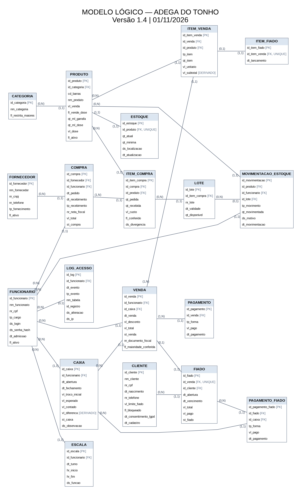

# Entrega 2 — Modelo Lógico, Implementação SQL e Apresentação Final

## Modelagem de um sistema de gestão de informações para uma organização de pequeno porte — Adega do Tonho

> **Atenção:** este é o Relatório Técnico Final e fica na raiz da branch `main`. Os campos marcados com **[PREENCHER]** dependem de informação que só o grupo tem (dados da adega, resultado de testes, material de outros integrantes). Antes de entregar, procure por `PREENCHER` e apague as notas em citação (`>`).

---

# Integrantes

| Nome completo do aluno | RGM | Usuário do GitHub |
| :--- | :--- | :--- |
| Kevin Gomes | 47796006 | [PREENCHER @usuario] |
| Brayan Antonio Daza Paredes | 50184857 **[conferir: igual ao do Gabriel Gonçalves Moura]** | [PREENCHER @usuario] |
| Gabriel dos Santos Eufrasio | 49005260 | [PREENCHER @usuario] |
| Gabriel Gonçalves Moura | 48892009 **[conferir: igual ao do Brayan]** | [PREENCHER @usuario] |
| Felipe Militão | 049331108 **[conferir: tem 9 dígitos, os outros têm 8]** | [PREENCHER @usuario] |

> O nome configurado na conta do GitHub de cada um precisa ser compatível com o nome desta tabela.

---

# 1. Relatório Técnico Final

## 1.1 Revisão do Modelo Conceitual

### 1.1.1 Caracterização da organização

**Nome e natureza da organização**

A organização é a **Adega do Tonho**, uma adega de bairro de pequeno porte, com fins lucrativos, que vende bebidas, alimentos, produtos para narguilé, cigarros e outros itens. É a mesma organização da Entrega 1; ela não foi trocada.

**Contexto e porte**

- Tempo de funcionamento: cerca de 4 anos.
- Pessoas envolvidas: cerca de 3 a 4, conforme o dia.
- Horário: segunda a quinta, das 13h às 23h; sexta a domingo, das 13h à meia-noite.
- Produtos vendidos: refrigerantes, cervejas, bebidas alcoólicas, doces, salgadinhos, sucos, itens de mercearia, itens para narguilé, cigarros e isqueiros. Há também bebidas separadas para venda em doses.
- Estrutura física: frente para atendimento e exposição; fundos para o estoque.
- Quantidade de produtos cadastrados (aproximada): **[PREENCHER]**.
- Vendas por dia ou por semana (aproximado): **[PREENCHER]**.
- Clientes que compram no fiado: **[PREENCHER]**.
- Compras de fornecedores por mês: **[PREENCHER]**.

> Estes quatro números são exigidos pelo professor e justificam o tamanho da massa de dados (seção 4). Peça o valor aproximado ao responsável; não estime.

**Problemas e necessidades identificados**

Os problemas abaixo vêm do que foi relatado na Entrega 1 (seção 1 do [`README_Entrega1.md`](Levantamento/README_Entrega1.md)). Cada um tem pelo menos uma consulta gerencial prevista na tabela de rastreabilidade da seção 1.6.

| Código | Problema identificado | Como o sistema poderá ajudar |
| :--- | :--- | :--- |
| P1 | Nas vendas comuns não se registra cada produto vendido, só o recebimento do pagamento. | `venda` e `item_venda` guardam produto, quantidade e preço de cada venda. |
| P2 | Diferenças entre a quantidade anotada e o estoque real. | `estoque` só muda por `movimentacao_estoque`, que registra produto, tipo, quantidade, funcionário e data. |
| P3 | Dificuldade para saber quais produtos mais saem. | Soma de `item_venda` por produto e por período. |
| P4 | Produtos que estão acabando são percebidos olhando as prateleiras. | `estoque.qt_minima` permite listar o que está no mínimo ou abaixo. |
| P5 | O fiado é controlado à mão, sem saldo, prazo e pagamentos parciais registrados de forma organizada. | `fiado`, `item_fiado`, `pagamento_fiado` e `cliente` guardam valor devido, limite, prazo e recebimentos. |

> Confirme com o responsável se P1 a P5 representam o que ele considera problema. Se quiserem incluir perdas, validade ou diferença de caixa como problema, é preciso que ele tenha confirmado; hoje esses processos são proposta do grupo (ver 1.1.3).

**Escopo do sistema**

O banco reúne os dados de toda a adega, não só do estoque: cadastro de produtos e categorias, estoque e movimentações, vendas e itens vendidos, pagamentos (inclusive divididos), clientes e fiado com seus recebimentos, compras e itens de compra, fornecedores, lotes e validade, funcionários, escala, caixa e log de ações sensíveis. São 18 entidades no DER conceitual e 19 tabelas no modelo lógico (18 + `log_acesso`).

**Justificativa da escolha**

A Adega do Tonho é uma organização real de pequeno porte, com processos de venda, pagamento, fiado, compra e estoque que cabem bem na modelagem relacional e ainda são controlados em caderno e celular. Um dos integrantes **trabalha na adega como funcionário e gerente** e fez a pesquisa de campo. Esse vínculo é declarado aqui; ele não substitui a comprovação da entrevista com o responsável. **[PREENCHER: confirmar qual integrante e se há parentesco com os donos.]**

**Evidências da organização**

As evidências ficam na pasta [`evidencias/`](evidencias/), em arquivos JPG ou PNG.

- Endereço completo: **[PREENCHER]**.
- Perfil no Google / Google Maps: **[PREENCHER link]**.
- Site ou rede social, se houver: **[PREENCHER link]**.
- Fotografias do local e da visita: **[PREENCHER nomes dos arquivos em `evidencias/`]**.

**Responsável pela organização**

- Nome: **[PREENCHER]**.
- Função: **[PREENCHER]**.
- Telefone para contato: **[PREENCHER, com autorização dele para o professor ligar]**.

### 1.1.2 Relato da entrevista

- **Quem participou:** **[PREENCHER: nome e função do entrevistado e dos integrantes presentes]**.
- **Quando:** **[PREENCHER data]**.
- **Onde:** **[PREENCHER: deve ser dentro da adega]**.
- **Comprovação:** **[PREENCHER: arquivo JPG ou PNG em `evidencias/`]**.

**Principais informações levantadas**

Resumo do que o grupo levantou (o texto completo está em [`Levantamento/Levantamento.md`](Levantamento/Levantamento.md)):

- Os preços são consultados em caderno ou etiqueta.
- Nas vendas comuns, o produto é entregue depois do pagamento e não há registro item a item. No fiado, anotam-se os produtos retirados e o valor devido.
- As compras de fornecedores são anotadas no celular, com produtos e quantidades. Na entrega, cada item é conferido antes de ir para o estoque.
- A falta de produto é percebida olhando prateleira e estoque.
- Quando uma garrafa é aberta para doses, deixa de poder ser vendida fechada, e isso é saída de estoque.
- Há diferença entre o que está anotado e o estoque real.

**Achados da observação presencial**

A pesquisa foi feita por um integrante que atua na adega e acompanha atendimento, vendas, conferência de estoque, compras, contato com fornecedores e controle do fiado. O que ele observou na rotina (organização da frente e dos fundos, caderno de preços, anotações no celular, conferência na entrega) está resumido acima. **[PREENCHER: separar aqui, em poucas linhas, o que foi observado do que o responsável respondeu na entrevista.]**

**Atualizações em relação à Entrega 1**

Depois da avaliação, o grupo acrescentou como **proposta de funcionamento do sistema** os processos de abertura e fechamento de caixa, cobrança e quitação do fiado, controle de validade, perdas e quebras e escala dos funcionários, e as entidades Caixa, Lote e Escala. Esses itens não foram observados na adega; vêm da correção do professor e de processos comuns em comércios parecidos. **[PREENCHER: se houve nova visita para confirmar com o responsável, descrever; se não houve, escrever que não houve e que as regras novas estão marcadas como proposta.]**

### 1.1.3 Processos de negócio

Os fluxogramas estão em [`Levantamento/processos.md`](Levantamento/processos.md): os processos 1 a 4 descrevem a adega hoje e a proposta de estoque; os processos 5 a 11 foram acrescentados depois da avaliação.

| Código | Processo | Descrição resumida | Origem | Está representado no modelo? |
| :--- | :--- | :--- | :--- | :--- |
| PR01 | Venda no balcão | Cliente escolhe os produtos, o funcionário confere preços e calcula o total, e a venda é paga. No sistema: data e hora, funcionário, caixa aberto, desconto, total e, por item, produto, quantidade e preço do dia. Bebida alcoólica e cigarro exigem conferência de maioridade. | Observado (fluxo 1) | Sim: `venda`, `item_venda`, `produto`, `funcionario`, `caixa` |
| PR02 | Pagamento de venda | Pix, cartão de débito ou crédito, dinheiro ou fiado. Uma venda pode ter mais de uma forma; a soma dos pagamentos fecha o total. | Observado; pagamento dividido é proposta (fluxo 11) | Sim: `pagamento` |
| PR03 | Venda fiada | Só cliente cadastrado, maior de 18 anos, com consentimento LGPD e dentro do limite. O fiado nasce de uma venda e marca as linhas que ficaram para pagar depois. | Observado (registro dos produtos retirados); regras são proposta (fluxo 11) | Sim: `fiado`, `item_fiado`, `cliente`, `item_venda` |
| PR04 | Recebimento de fiado | Pagamento total ou parcial, com data, valor, forma e caixa que recebeu. Atualiza o saldo e libera o cliente. | Proposta (fluxo 7) | Sim: `pagamento_fiado`, `fiado`, `caixa` |
| PR05 | Compra de produtos | Funcionário anota o que falta; o gerente faz o pedido ao fornecedor, por entrega ou retirada. | Observado (fluxo 2) | Sim: `compra`, `item_compra`, `fornecedor`, `funcionario` |
| PR06 | Recebimento e conferência | Cada item é conferido contra o pedido; erro ou falta volta ao fornecedor e só o conferido entra no estoque. | Observado (fluxo 2) | Sim: `item_compra` (`qt_recebida`, `fl_conferido`, divergência) |
| PR07 | Controle de estoque | Conferência manual das quantidades e anotação do que falta. No sistema: saldo e mínimo por produto. | Observado (fluxo 3) | Sim: `estoque` |
| PR08 | Movimentação de estoque | Entradas, saídas por venda, garrafa aberta para dose, perdas e ajustes, sempre com funcionário e data. | Observado em parte (fluxos 3 e 4) | Sim: `movimentacao_estoque` |
| PR09 | Perdas e validade | Quebra, avaria e vencimento saem do estoque com motivo e aprovação do gerente; lotes a 30 dias de vencer são sinalizados. | Proposta (fluxos 8 e 9) | Sim: `lote`, `movimentacao_estoque`, `log_acesso` |
| PR10 | Abertura e fechamento de caixa | Troco inicial na abertura; no fechamento, conta-se o dinheiro, compara-se com o esperado e justifica-se a diferença. | Proposta (fluxos 5 e 6) | Sim: `caixa` |
| PR11 | Cadastro e atualização de produtos | Nome, categoria, código de barras, preço de venda, dose (volume da garrafa, volume e preço da dose) e situação ativo/inativo. | Observado (consulta e organização de preços) | Sim: `produto`, `categoria` |
| PR12 | Escala de funcionários | O gerente define, para cada turno, quem trabalha e em qual função. | Proposta (fluxo 10) | Sim: `escala` |

**Processos típicos não incluídos**

| Processo provável | Motivo de não inclusão |
| :--- | :--- |
| Entrega em domicílio | **[CONFIRMAR com o responsável]** A Entrega 1 só descreve atendimento no balcão. |
| Emissão de nota fiscal pelo sistema | O sistema apenas guarda a chave do documento fiscal na venda (RN28). A emissão é feita por outro meio; o regime tributário deve ser confirmado com o contador. |
| Folha de pagamento e comissões | Fora do escopo de gestão de estoque, vendas e fiado; **[CONFIRMAR]** se a adega quer isso. |
| Programa de fidelidade e promoções | Não foram citados na pesquisa de campo. **[CONFIRMAR]** |

> Não mantenha nesta tabela algo que a adega realmente faz. Confira com o responsável.

### 1.1.4 Requisitos do sistema

Texto completo em [`Levantamento/Requisitos.md`](Levantamento/Requisitos.md). Os valores de medida dos requisitos não funcionais são propostas do grupo.

**Requisitos funcionais**

| Código | Requisito funcional |
| :--- | :--- |
| RF01 | **Cadastro de produtos.** O sistema deve permitir cadastrar os produtos comercializados pela adega, incluindo nome, categoria e preço. |
| RF02 | **Consulta de produtos.** O sistema deve permitir consultar os produtos cadastrados, seus respectivos preços e as quantidades disponíveis. |
| RF03 | **Controle de estoque.** O sistema deve permitir consultar a quantidade disponível de cada produto em estoque, considerando a localização geral informada para o armazenamento. |
| RF04 | **Registro de entrada de produtos.** O sistema deve permitir registrar a entrada de produtos no estoque, informando o produto, a quantidade e a data do recebimento. |
| RF05 | **Registro de saída de produtos.** O sistema deve permitir registrar a saída de produtos do estoque, identificando o motivo, como venda, perda, quebra ou vencimento. |
| RF06 | **Registro de produtos utilizados para doses.** O sistema deve permitir registrar como saída do estoque as bebidas abertas para preparação de doses, atualizando a quantidade disponível. |
| RF07 | **Registro de vendas.** O sistema deve permitir registrar as vendas realizadas, incluindo os produtos vendidos, suas respectivas quantidades, os preços unitários e o valor total da venda. |
| RF08 | **Registro da forma de pagamento.** O sistema deve permitir registrar uma ou mais formas de pagamento utilizadas em cada venda, considerando Pix, dinheiro, cartão de crédito, cartão de débito e fiado. Quando houver fiado, o sistema deve registrar o valor destinado ao pagamento posterior e vinculá-lo à conta de fiado da venda. |
| RF09 | **Cadastro de clientes que utilizam fiado.** O sistema deve permitir cadastrar clientes que realizam compras por meio de fiado, armazenando seus dados de identificação. |
| RF10 | **Controle de fiado.** O sistema deve permitir registrar cada compra realizada por fiado, vinculando o cliente, a venda de origem, os produtos adquiridos, as quantidades e o valor total devido. |
| RF11 | **Controle do limite de fiado.** O sistema deve permitir cadastrar e consultar o limite de fiado de cada cliente e impedir a realização de novas compras que ultrapassem o limite disponível. |
| RF12 | **Cadastro de fornecedores.** O sistema deve permitir cadastrar os fornecedores utilizados pela adega, armazenando seus dados de identificação e contato. |
| RF13 | **Registro de compras.** O sistema deve permitir registrar as compras realizadas com fornecedores, incluindo os produtos, suas quantidades, os preços unitários e o valor total da compra. |
| RF14 | **Consulta de produtos com baixa quantidade.** O sistema deve permitir identificar os produtos que estejam com quantidade baixa em estoque ou que necessitem de reposição. |
| RF15 | **Consulta de produtos com maior saída.** O sistema deve permitir consultar os produtos com maior quantidade vendida em determinado período, auxiliando no planejamento de reposição e compras. |
| RF16 | **Identificação dos funcionários.** O sistema deve permitir cadastrar e identificar os funcionários responsáveis pelas operações realizadas, vinculando-os aos registros de vendas, movimentações de estoque e compras. |
| RF17 | **Abertura de caixa.** O sistema deve permitir abrir o caixa informando o troco inicial e o funcionário responsável, permitir apenas um caixa aberto por vez e impedir vendas e recebimentos quando não houver caixa aberto. |
| RF18 | **Fechamento de caixa.** O sistema deve permitir fechar o caixa registrando o dinheiro contado, calcular o valor esperado, mostrar a diferença e exigir uma justificativa quando a diferença for diferente de zero. |
| RF19 | **Pagamento do fiado.** O sistema deve permitir registrar pagamentos totais ou parciais de um fiado, atualizar o saldo devedor do cliente e liberar o cliente para novas compras quando não houver fiado vencido. |
| RF20 | **Controle de validade.** O sistema deve permitir registrar o lote e a data de validade dos produtos perecíveis no recebimento e sinalizar os lotes vencidos e os que vencem em até 30 dias. |
| RF21 | **Conferência de maioridade.** O sistema deve exigir a confirmação de que o comprador é maior de 18 anos antes de concluir a venda de bebida alcoólica ou de produtos de tabaco. |
| RF22 | **Escala dos funcionários.** O sistema deve permitir cadastrar os turnos de trabalho de cada funcionário, informando o dia, o horário e a função exercida. |
| RF23 | **Aprovação de perdas.** O sistema deve exigir motivo e aprovação do gerente para registrar perdas, quebras e ajustes de estoque. |
| RF24 | **Conferência do recebimento.** O sistema deve permitir conferir item a item as mercadorias recebidas, registrar divergências (produto errado, faltante ou avariado) e só dar entrada no estoque do que foi conferido. |

**Requisitos não funcionais**

| Código | Requisito não funcional | Critério ou medida |
| :--- | :--- | :--- |
| RNF01 | **Facilidade de uso.** O sistema deve possuir uma interface simples e intuitiva, considerando que atualmente os controles são realizados manualmente por meio de caderno e celular. | Teste de uso com um funcionário da adega |
| RNF02 | **Rapidez.** O sistema deve apresentar as informações de produtos, preços e estoque em até 2 segundos, principalmente durante a rotina de atendimento. | Até 2 segundos para consultar produto, preço e estoque |
| RNF03 | **Integridade das informações.** O sistema deve manter as informações de produtos, vendas, compras e estoque de forma consistente, evitando registros incorretos que possam causar diferenças na quantidade disponível. | Auditorias do script sem divergência |
| RNF04 | **Segurança.** O sistema deve proteger as informações registradas, permitindo acesso às funções de acordo com o nível de autorização definido para cada usuário (atendente ou gerente). | Dois perfis (atendente e gerente) com permissões diferentes |
| RNF05 | **Disponibilidade.** As informações de estoque, produtos, vendas e compras devem estar disponíveis para consulta durante todo o horário de funcionamento da adega (13h às 23h de segunda a quinta e 13h às 00h de sexta a domingo), com no máximo 15 minutos de indisponibilidade por semana dentro desse horário. | Disponível no horário de funcionamento, no máximo 15 min de indisponibilidade |
| RNF06 | **Cópia de segurança.** O sistema deve permitir a realização de cópias de segurança dos dados, com pelo menos uma cópia por dia, para reduzir o risco de perda das informações registradas. | Pelo menos uma cópia por dia |
| RNF07 | **Compatibilidade.** O sistema deve poder ser utilizado em computadores e dispositivos móveis, como celulares, considerando as necessidades da rotina de atendimento da adega. | Funciona em computador e celular |
| RNF08 | **Proteção de dados pessoais.** O sistema deve tratar os dados pessoais dos clientes do fiado e dos funcionários conforme a Lei Geral de Proteção de Dados (Lei 13.709/2018), registrando o consentimento do cliente e limitando o acesso a esses dados. | Consentimento registrado e acesso restrito (RN29) |
| RNF09 | **Rastreabilidade.** O sistema deve registrar em log quem fez cada ação sensível (alteração de preço, perda de estoque, limite de fiado, cancelamento de venda, caixa e dados pessoais), com data e hora, e esse registro não pode ser alterado. | Todo evento sensível gera linha em `log_acesso`, sem edição |

**Requisitos típicos não incluídos**

| Requisito provável | Motivo de não inclusão |
| :--- | :--- |
| Pedido on-line ou cardápio digital | O processo real é atendimento no balcão. **[CONFIRMAR]** |
| Emissão de nota fiscal eletrônica | Ver RN28: o sistema guarda só a chave do documento. |
| Integração com maquininha de cartão ou Pix | Não foi pedida e depende de contratos externos. O sistema só registra a forma e o valor do pagamento. |
| Relatórios contábeis completos | Fora do escopo; o foco é gestão operacional. |

### 1.1.5 Regras de negócio

Texto completo em [`Levantamento/regras_de_negocio.md`](Levantamento/regras_de_negocio.md). As regras RN22 a RN25 e os números de prazo (30 dias no fiado e no aviso de validade) são **propostas do grupo**, não práticas observadas na adega.

| Código | Regra de negócio |
| :--- | :--- |
| RN01 | Toda venda é feita por um funcionário identificado e registrada em um caixa **aberto**. Sem caixa aberto, o sistema não permite vender. |
| RN02 | As formas de pagamento aceitas são dinheiro, PIX, cartão de débito, cartão de crédito e fiado. Uma venda pode ser paga com mais de uma forma (pagamento dividido). |
| RN03 | A venda só é concluída quando a soma dos pagamentos é igual ao valor total da venda. |
| RN04 | O preço do item é o preço do cadastro no momento da venda e fica gravado no item. Mudar o preço depois não altera vendas já feitas. |
| RN05 | Toda venda concluída gera saída de estoque: uma movimentação de saída por item vendido. |
| RN06 | Dose só pode ser vendida de produto cadastrado para isso. A garrafa aberta para servir doses **sai do estoque no momento da abertura** (1 unidade, tipo SAIDA_DOSE). As doses vendidas depois são itens do tipo DOSE e não baixam estoque de novo. |
| RN07 | Somente o gerente cancela uma venda concluída. O cancelamento devolve os itens ao estoque (ajuste de entrada com motivo) e fica registrado no log. |
| RN08 | Só compra fiado o cliente **cadastrado**, maior de 18 anos, com consentimento LGPD registrado e que não esteja bloqueado. |
| RN09 | Todo fiado é vinculado a um cliente e nasce de uma única venda. Não existe fiado sem cliente identificado. |
| RN10 | O saldo devedor do cliente somado à nova compra não pode passar do limite de fiado dele. O limite é definido somente pelo gerente. Se passar, a venda fiada é recusada. |
| RN11 | Somente os itens destinados integralmente ao pagamento posterior são lançados em ITEM_FIADO, vinculados à linha correspondente de ITEM_VENDA. Em pagamento dividido, cada linha de item é atribuída a uma forma de pagamento; quando necessário, o mesmo produto pode aparecer em linhas separadas. O total de ITEM_FIADO deve corresponder ao valor lançado na forma FIADO. |
| RN12 | O fiado tem prazo de **30 dias** a partir da abertura (prazo proposto pelo grupo, ajustável). Fiado vencido bloqueia o cliente para novas compras fiadas até a quitação. |
| RN13 | O cliente pode pagar o fiado total ou parcialmente. O recebimento é registrado somente em PAGAMENTO_FIADO, entra no caixa e abate o saldo. Não é somado novamente aos pagamentos da venda original. Quando o saldo chega a zero, o fiado é marcado como quitado e o cliente é liberado se não tiver outro fiado vencido. |
| RN14 | O saldo de estoque nunca é editado direto. Toda entrada e saída acontece por uma movimentação, que não pode ser alterada nem apagada. |
| RN15 | Perdas e quebras (quebra, avaria, vencimento, furto) saem do estoque com **motivo obrigatório** e **aprovação do gerente**, registrada no log. |
| RN16 | O produto precisa de reposição quando o saldo fica igual ou abaixo do mínimo cadastrado. Qualquer funcionário pode sinalizar a falta antes disso. |
| RN17 | Produto com validade é recebido por lote. Lote vencido é retirado da venda e baixado como perda. Lote a 30 dias do vencimento é sinalizado. Na venda, sai primeiro o lote que vence antes. |
| RN18 | Qualquer funcionário identifica a necessidade de reposição, mas a compra é feita pelo gerente ou por funcionário autorizado por ele, sempre em fornecedor cadastrado. |
| RN19 | Cada fornecedor atende por entrega, retirada ou ambos. A compra registra como a mercadoria chegou. |
| RN20 | No recebimento, cada item é conferido contra o pedido e a nota fiscal. A mercadoria só entra no estoque depois de conferida. |
| RN21 | Mercadoria errada, faltante ou avariada não entra no estoque. A divergência é descrita e a mercadoria volta ao fornecedor. A compra fica como recebida parcialmente. |
| RN22 | Antes de vender, o caixa é aberto por um funcionário, que conta e informa o troco inicial. Só pode haver um caixa aberto por vez, e a abertura fica registrada no log com data, hora e responsável. |
| RN23 | No fechamento, conta-se o dinheiro, compara-se com o valor esperado e registra-se a diferença. Diferença diferente de zero exige justificativa e conferência do gerente. |
| RN24 | Caixa fechado não aceita vendas nem recebimento de fiado. |
| RN25 | A escala é montada pelo gerente e define, para cada turno, quem trabalha e em qual função. A quantidade de pessoas escaladas deve refletir a equipe disponível; o sistema não exige duas pessoas em todos os turnos. |
| RN26 | É **proibido vender, servir ou entregar bebida alcoólica a menor de 18 anos**, nem de graça. Na dúvida sobre a idade, o atendente exige documento oficial com foto. Sem a conferência, a venda de item de categoria restrita não pode ser concluída. |
| RN27 | É **proibido vender cigarros e outros produtos de tabaco a menor de 18 anos**. Vale a mesma conferência de documento da RN26. |
| RN28 | Toda venda deve ter o documento fiscal exigido para o regime tributário da adega (cupom ou NFC-e), conforme a legislação do estado. Quando emitido, a chave fica registrada na venda. |
| RN29 | Os dados pessoais dos clientes do fiado (nome, CPF, nascimento e telefone) são coletados com consentimento, usados só para controle e cobrança do fiado e acessados apenas por gerente e atendente do balcão. O cliente pode pedir acesso, correção e eliminação dos dados. |
| RN30 | Cada funcionário tem perfil de **atendente** ou **gerente**, com permissões diferentes. Ações sensíveis (preço, estoque, limite de fiado, cancelamento, caixa e dados pessoais) são registradas em log com autor, data e hora. |

**Regras típicas não incluídas**

| Regra provável | Motivo de não inclusão |
| :--- | :--- |
| Desconto máximo por funcionário | A adega não relatou política de desconto; o sistema só guarda o desconto da venda. **[CONFIRMAR]** |
| Juros ou multa sobre fiado atrasado | Não foi relatado. O atraso só bloqueia novas compras fiadas (RN12). **[CONFIRMAR]** |
| Troca e devolução de produto | Não foi relatada; o cancelamento de venda é tratado na RN07. **[CONFIRMAR]** |

### 1.1.6 DER conceitual revisado

- **Arquivo editável / imagem:** [`Diagramas/der_conceitual`](Diagramas/der_conceitual) **[PREENCHER: nome e extensão do arquivo do brModelo e da imagem exportada]**.
- **Software utilizado:** **[PREENCHER: brModelo, com a versão]**. O DER precisa estar na notação do brModelo (retângulo, losango, círculo preenchido para a chave).
- **Texto de apoio:** [`Diagramas/der_conceitual.md`](Diagramas/der_conceitual.md) traz o mesmo diagrama em texto (Mermaid, que o GitHub desenha) e a tabela dos 22 relacionamentos com cardinalidade mínima e máxima. Ele é apoio; a figura oficial é a do brModelo.

O DER tem 18 entidades e 22 relacionamentos, todos com cardinalidade mínima e máxima, e **não mostra chaves estrangeiras**.

**Registro das correções da Entrega 1**

| Apontamento da correção da Entrega 1 | O que mudou no trabalho | Justificativa |
| :--- | :--- | :--- |
| Cardinalidade só máxima | Os 22 relacionamentos passaram a ter mínima e máxima: (0,1), (1,1), (0,N) ou (1,N). | O mínimo diz se a participação é obrigatória e define se a FK aceita nulo. |
| Chaves estrangeiras desenhadas no DER conceitual | Removidas. O conceitual mostra só o identificador e os atributos. | FK é decisão do modelo lógico. |
| Dois relacionamentos entre Venda e Pagamento | Ficou um só: Venda (1,N) é paga por Pagamento. | Dois caminhos entre as mesmas entidades geram ambiguidade. |
| Estoque ligado à Venda | Ligação removida. Estoque liga só a Produto (1:1). A saída por venda passa por Item da Venda → Produto → Movimentação de Estoque. | A venda não altera o estoque diretamente. |
| Processos sem entidade (caixa, validade, escala) | Entidades Caixa, Lote e Escala acrescentadas (de 15 para 18). | Cada processo precisa de dados para ser registrado. |
| Fiado sem ligação com a venda | O fiado nasce de uma única venda e o item do fiado marca a linha de `item_venda`. Produto, quantidade e preço não são copiados para o fiado. | Evita dados repetidos que poderiam divergir. |
| Lote preso a um item de compra por 1:1 | Item da Compra (0,N) — Lote (1,1). | Um item recebido pode ter lotes com validades diferentes. |
| Funcionário sem ligação com Movimentação e Compra | Ligações criadas. | A regra exige saber quem fez cada movimentação e cada compra (RN14, RN18). |
| Arquivo de regras sem extensão | Renomeado para `regras_de_negocio.md`. | Não abriu na avaliação. |
| Texto do RF04 trocado com o RNF04 | RF04 restaurado. | Erro de colagem. |
| RNF02 (rapidez) e RNF05 (disponibilidade) sem medida | Medidas propostas: 2 segundos e no máximo 15 minutos de indisponibilidade. | Requisito sem medida não é verificável. |

> **[PREENCHER]** Confira esta tabela com o relatório de avaliação que o grupo recebeu e acrescente qualquer apontamento que não esteja aqui. Apontamento não citado é tratado como não corrigido.

---

## 1.2 Conversão do Modelo Conceitual para o Modelo Lógico

O documento completo, com cada tabela, coluna, tipo e restrição, está em [`Docs/modelo_logico.md`](Docs/modelo_logico.md). Ele e o script são gerados da mesma fonte e não se contradizem.

**Entidades para tabelas**

Cada uma das 18 entidades virou uma tabela, com nome no singular e minúsculo (`produto`, `item_venda`). Foi acrescentada a tabela de apoio `log_acesso` (fora do DER), que registra quem fez cada ação sensível (RN30). Total: 19 tabelas.

**Atributos para colunas**

O nome da coluna tem um prefixo que mostra o tipo do dado: `id_` identificador, `nm_` nome, `vl_` valor em reais, `qt_` quantidade, `dt_` data, `hr_` hora, `fl_` verdadeiro ou falso, `st_` situação, `tp_` tipo, `nr_` número de documento, `ds_` descrição. Valores em dinheiro usam `DECIMAL`, nunca `FLOAT`. São 134 colunas. `vl_subtotal` (item da venda) e `vl_diferenca` (caixa) são colunas geradas pelo MySQL.

**Relacionamentos para chaves**

A chave primária do lado "1" entra como chave estrangeira no lado "N". Se o mínimo do lado "1" é 1, a FK é `NOT NULL`; se é 0, aceita nulo (exemplo: `movimentacao_estoque.id_lote`). São 23 FKs, todas com RESTRICT: não se apaga o que ainda é usado. Produto com histórico é inativado, não excluído.

**Tratamento das cardinalidades**

| Cardinalidade no DER | Como foi implementada no modelo lógico |
| :--- | :--- |
| 1:1 | Produto–Estoque: `estoque.id_produto` com `UNIQUE`. Venda–Fiado: `fiado.id_venda` com `UNIQUE`. Item da Venda–Item do Fiado: `item_fiado.id_item_venda` com `UNIQUE`. |
| 1:N | FK no lado N. Exemplos: `produto.id_categoria`, `venda.id_funcionario`, `venda.id_caixa`, `pagamento.id_venda`, `compra.id_fornecedor`, `lote.id_item_compra`. |
| N:N | Venda × Produto virou `item_venda`; Compra × Produto virou `item_compra`. As duas têm atributos próprios (quantidade e preço ou custo). `item_fiado` não é associativa: só marca uma linha de `item_venda`. |

**Generalização/especialização**

O DER não tem generalização/especialização, então não houve estratégia de conversão para isso. Os perfis atendente e gerente são um atributo de `funcionario` (`tp_cargo`).

## 1.3 Definição de Chaves Primárias e Estrangeiras

Todas as tabelas têm chave primária inteira e automática (`AUTO_INCREMENT`).

| Tabela | Chave primária (PK) | Chave(s) estrangeira(s) (FK) |
| :--- | :--- | :--- |
| categoria | id_categoria | não possui |
| produto | id_produto | id_categoria |
| estoque | id_estoque | id_produto (único) |
| funcionario | id_funcionario | não possui |
| escala | id_escala | id_funcionario |
| cliente | id_cliente | não possui |
| caixa | id_caixa | id_funcionario |
| venda | id_venda | id_funcionario, id_caixa |
| fiado | id_fiado | id_venda (único), id_cliente |
| item_venda | id_item_venda | id_venda, id_produto |
| pagamento | id_pagamento | id_venda |
| item_fiado | id_item_fiado | id_item_venda (único) |
| pagamento_fiado | id_pagamento_fiado | id_fiado, id_caixa |
| fornecedor | id_fornecedor | não possui |
| compra | id_compra | id_fornecedor, id_funcionario |
| item_compra | id_item_compra | id_compra, id_produto |
| lote | id_lote | id_item_compra |
| movimentacao_estoque | id_movimentacao | id_produto, id_funcionario, id_lote (aceita nulo) |
| log_acesso | id_log | id_funcionario |

Conferido contra o `Docs/script.sql`: 19 tabelas e 23 FKs.

## 1.4 Processo de Normalização (1FN, 2FN e 3FN)

O texto completo, com um exemplo partindo do caderno da adega, está em [`Docs/normalizacao.md`](Docs/normalizacao.md).

**Primeira Forma Normal (1FN)**

Uma venda anotada no caderno tem vários produtos e vários pagamentos na mesma linha. Cada produto passou a ser uma linha em `item_venda` e cada pagamento uma linha em `pagamento`. A data e hora ficaram em uma coluna `DATETIME`, e a medida da dose em número (`qt_ml_dose`), não em texto como "50 ml". O mesmo vale para `item_compra`.

**Segunda Forma Normal (2FN)**

Em `item_venda`, nome e categoria do produto dependiam só do produto, e não da venda. Foram para `produto`. No item ficaram quantidade e preço cobrado, que dependem da venda e do produto juntos. Como todas as tabelas têm chave primária simples, a 2FN é atendida; foi verificada de fato nas tabelas com combinação única natural (`escala`, `item_compra`).

**Terceira Forma Normal (3FN)**

Nome e cargo do funcionário saíram de `venda` para `funcionario`. A regra de maioridade saiu de `produto` para `categoria` (`fl_restrita_maiores`). O mesmo foi feito com fornecedor (em `compra`), cliente (em `fiado`) e caixa (em `venda`).

**Justificativa do processo de normalização**

Sem a normalização, trocar o cargo de um funcionário, o preço ou a categoria de um produto exigiria alterar várias linhas e deixaria vendas antigas contraditórias. Com ela, cada informação existe em um lugar só. O preço cobrado fica no item de propósito, porque é o preço do dia da venda e não pode mudar quando o preço do produto mudar.

**Exceções deliberadas à 3FN**

Algumas colunas guardam um valor que poderia ser calculado, por desempenho no balcão ou por refletirem um documento: `venda.vl_total`, `estoque.qt_atual`, `fiado.vl_total`, `fiado.vl_pago`, `fiado.st_fiado`, `caixa.vl_esperado`, `compra.vl_total` e `lote.qt_disponivel`. Cada uma tem uma consulta de auditoria prevista para pegar divergência (ver seção 3). `log_acesso.ds_alteracao` é JSON para guardar o antes e o depois de um registro; foge da 1FN estrita porque só é lido inteiro.

## 1.5 Justificativas Técnicas das Decisões

**Chaves primárias**

Chave substituta inteira e automática em todas as tabelas. CPF, CNPJ e código de barras podem mudar, faltar ou ser digitados errado; uma chave pequena e estável deixa as junções mais rápidas e as FKs menores. CPF, CNPJ, código de barras e login continuam únicos por `UNIQUE`.

**Chaves estrangeiras e relacionamentos**

As 23 FKs implementam os 22 relacionamentos do DER (um deles, Movimentação de Estoque, é ligado a três tabelas). Todas usam RESTRICT para que histórico de venda, compra e estoque nunca fique sem origem. Exemplos: `venda.id_caixa` implementa a RN01 (venda só em caixa aberto); `fiado.id_venda` implementa a RN09 (fiado nasce de uma venda); `movimentacao_estoque.id_funcionario` implementa a RN14.

**Restrições de integridade**

| Restrição implementada | Tabela/coluna | Regra de negócio relacionada | Justificativa |
| :--- | :--- | :--- | :--- |
| NOT NULL | `venda.id_funcionario`, `venda.id_caixa` | RN01 | Toda venda tem funcionário e caixa. |
| NOT NULL | `fiado.id_cliente`, `fiado.id_venda` | RN09 | Não existe fiado sem cliente nem sem venda de origem. |
| NOT NULL | `lote.id_item_compra` | RN17 | Lote sempre vem de uma compra recebida. |
| UNIQUE | `cliente.nr_cpf`, `funcionario.nr_cpf`, `fornecedor.nr_cnpj` | RN08, RN18, RN29 | Evita cadastro duplicado. |
| UNIQUE | `funcionario.ds_login` | RN30 | Identifica quem faz cada ação sensível. |
| UNIQUE | `produto.cd_barras`, `categoria.nm_categoria` | RN04 | Evita produto e categoria repetidos. |
| UNIQUE | `estoque.id_produto` | RN14 | Um único saldo por produto (relação 1:1). |
| UNIQUE | `fiado.id_venda`, `item_fiado.id_item_venda` | RN09, RN11 | Um fiado por venda; uma linha da venda entra no fiado só uma vez. |
| UNIQUE | `escala (id_funcionario, dt_turno, hr_inicio)` | RN25 | Mesmo turno não se repete para o mesmo funcionário. |
| CHECK | `produto.vl_venda >= 0` | RN04 | Preço não negativo. |
| CHECK | `produto` (dose menor ou igual à garrafa e campos de dose preenchidos) | RN06 | Dose só existe para produto cadastrado para isso. |
| CHECK | `estoque.qt_atual >= 0` | RN14 | Estoque não fica negativo. |
| CHECK | `item_venda.qt_item > 0`, `pagamento.vl_pago > 0` | RN02, RN03 | Item e pagamento com valor positivo. |
| CHECK | `pagamento_fiado.vl_pago > 0`, `fiado.vl_pago <= vl_total` | RN13 | Recebimento positivo e que não passa da dívida. |
| CHECK | `cliente.vl_limite_fiado >= 0` | RN10 | Limite não negativo. |
| CHECK | `caixa` (aberto sem data de fechamento; fechado com data e valor contado) | RN22, RN23 | Estado do caixa coerente. |
| CHECK | `movimentacao_estoque` (perda e ajuste exigem motivo) | RN15 | Perda sem motivo não passa. |
| CHECK | `item_compra.qt_recebida <= qt_pedida` | RN20, RN21 | Não se recebe mais do que o pedido. |
| DEFAULT | `caixa.st_caixa = 'ABERTO'`, `venda.st_venda = 'CONCLUIDA'` | RN22 | Situação inicial padrão. |
| DEFAULT | `categoria.fl_restrita_maiores = 0`, `venda.fl_maioridade_conferida = 0` | RN26, RN27 | A venda restrita só passa depois da conferência. |
| DEFAULT | `cliente.fl_bloqueado = 0`, `produto.fl_ativo = 1`, `estoque.qt_atual = 0` | RN08 | Valores iniciais seguros. |

**Decisões arquiteturais**

- **Venda separada de item da venda e de pagamento:** uma venda tem vários produtos e várias formas de pagamento (pagamento dividido).
- **Estoque só muda por movimentação (RN14):** o saldo em `estoque` é conferido contra o histórico; nada é editado direto.
- **Fiado nasce da venda:** o recebimento posterior fica só em `pagamento_fiado`, sem criar segundo pagamento da venda original. `item_fiado` marca a linha de `item_venda`, sem copiar produto, quantidade ou preço.
- **Lote:** um item de compra pode originar vários lotes, com validades diferentes (RN17).
- **Caixa:** vendas e recebimentos de fiado ficam ligados a uma sessão de caixa, para o fechamento (RN22 a RN24).
- **`log_acesso`:** registro imutável de ações sensíveis (RN30), necessário também para a LGPD (RN29).

## 1.6 Proposta de Arquitetura Analítica para BI e IA

**Informações estratégicas**

Com os dados registrados item a item, a gestão da adega passa a saber: quais produtos mais saem e em quais horários e dias; quanto cada forma de pagamento representa; quanto está para receber no fiado e de quem; quais produtos estão abaixo do mínimo; quanto se perde por quebra e vencimento; qual a margem entre custo (`item_compra.vl_custo`) e preço de venda; e se o caixa fecha sem diferença.

**Indicadores e métricas gerenciais (KPIs)**

| Código | KPI | Fórmula | Período | Meta, se definida |
| :--- | :--- | :--- | :--- | :--- |
| KPI01 | Faturamento | Soma de `venda.vl_total` das vendas concluídas | Dia, semana e mês | Não definida |
| KPI02 | Ticket médio | Faturamento ÷ número de vendas concluídas | Semana e mês | Não definida |
| KPI03 | Produtos mais vendidos | Soma de `item_venda.qt_item` por produto | Mês | Não definida |
| KPI04 | Produtos no mínimo ou abaixo | Contagem de produtos com `qt_atual <= qt_minima` | Diário | Zero produtos abaixo do mínimo sem pedido de compra |
| KPI05 | Saldo de fiado em aberto | Soma de (`vl_total` − `vl_pago`) dos fiados abertos | Semanal | Não definida |
| KPI06 | Fiado vencido | Fiados abertos com mais de 30 dias ÷ fiados abertos | Semanal | Não definida |
| KPI07 | Perdas e quebras | Soma da quantidade de movimentações do tipo PERDA | Mês | Não definida |
| KPI08 | Diferença de caixa | Soma de `caixa.vl_diferenca` dos caixas fechados | Dia | Zero |

> **[PREENCHER]** O Integrante 5 confirma os KPIs finais com o responsável. Um KPI só vale se existir consulta no script que o calcule.

**Potencial dos dados para BI**

As tabelas de movimento (`venda`, `item_venda`, `pagamento`, `movimentacao_estoque`, `fiado`, `compra`) têm data e valor, e se ligam às tabelas de cadastro (`produto`, `categoria`, `funcionario`, `cliente`, `fornecedor`). Isso permite um painel de vendas por produto, categoria, forma de pagamento e funcionário; um painel de estoque com mínimo e validade; um painel de fiado com saldo e atraso; e um painel de compras por fornecedor. As consultas gerenciais do script alimentam cada painel.

**Aplicações analíticas e de IA**

*Possíveis no futuro, não implementadas neste trabalho:* previsão de reposição a partir da saída histórica por produto; identificação de dias e horários de pico para escala; sugestão de limite de fiado a partir do histórico de pagamento do cliente; alerta de produtos de baixa saída parados em estoque. O banco já guarda os dados de entrada necessários; falta o volume de histórico real para treinar qualquer modelo.

**Tabela de rastreabilidade dos problemas e KPIs**

| Problema ou KPI | Tabelas envolvidas | Consulta no script SQL |
| :--- | :--- | :--- |
| P1 — Vendas sem registro por item | venda, item_venda, produto | **[PREENCHER G__]** |
| P2 — Estoque anotado diferente do real | estoque, movimentacao_estoque | **[PREENCHER G__]**; auditoria **[A__]** |
| P3 — Produtos que mais saem | item_venda, produto, categoria | **[PREENCHER G__]** |
| P4 — Produtos acabando | estoque, produto | **[PREENCHER G__]** |
| P5 — Controle do fiado | fiado, pagamento_fiado, cliente, venda | **[PREENCHER G__]** |
| KPI01 — Faturamento | venda | **[PREENCHER G__]** |
| KPI02 — Ticket médio | venda | **[PREENCHER G__]** |
| KPI03 — Produtos mais vendidos | item_venda, produto | **[PREENCHER G__]** |
| KPI04 — Produtos no mínimo | estoque, produto | **[PREENCHER G__]** |
| KPI05 — Saldo de fiado | fiado, cliente | **[PREENCHER G__]** |
| KPI06 — Fiado vencido | fiado, cliente | **[PREENCHER G__]** |
| KPI07 — Perdas e quebras | movimentacao_estoque, lote, produto | **[PREENCHER G__]** |
| KPI08 — Diferença de caixa | caixa, venda, pagamento | **[PREENCHER G__]** |

> Cada problema e cada KPI precisa de pelo menos uma consulta com código G (gerencial) no script. Preencher quando o Integrante 4 fechar as consultas.

---

# 2. Modelo Lógico Relacional

O modelo lógico mostra as 19 tabelas, colunas com tipo, chaves primárias, chaves estrangeiras e as cardinalidades já convertidas.

- **Software utilizado:** **[PREENCHER: brModelo, com a versão]**.
- **Arquivo editável:** [`Diagramas/modelo_logico.brm`](Diagramas/modelo_logico.brm).
- **Imagem exportada para visualização:** **[PREENCHER: exportar o `.brm` para PNG e colocar o caminho aqui, por exemplo `Diagramas/modelo_logico_brmodelo.png`]**.
- **Apoio:** [`Diagramas/modelo_logico.png`](Diagramas/modelo_logico.png) e [`Diagramas/modelo_logico.dbml`](Diagramas/modelo_logico.dbml) (abre no dbdiagram.io), gerados do mesmo modelo.

As demais restrições (`NOT NULL`, `UNIQUE`, `CHECK`, `DEFAULT`) não aparecem no diagrama do brModelo e estão no [dicionário de dados](Docs/dicionario_dados.html) e no [script SQL](Docs/script.sql).

> **[PREENCHER]** Antes de entregar, confira o `.brm` com o modelo atual: 22 ligações; `item_fiado` só com `id_item_fiado`, `id_item_venda` (único) e `dt_lancamento`; `pagamento` sem coluna `id_fiado`; `lote.id_item_compra` sem `UNIQUE`.

---

# 3. Script SQL Completo

O script contém a implementação do banco no MySQL.

- **SGBD:** MySQL 8.0 **[PREENCHER: versão em que foi realmente executado]**.
- **Arquivo:** [`Docs/script.sql`](Docs/script.sql) (criação do banco, tabelas e restrições).
- **Exemplos de INSERT, UPDATE, DELETE, JOIN e auditoria:** [`Docs/exemplos_basicos.sql`](Docs/exemplos_basicos.sql).
- **Massa de dados:** [`Docs/massa_de_dados.sql`](Docs/massa_de_dados.sql).
- **Consultas gerenciais e de auditoria:** **[PREENCHER: arquivo do Integrante 4]**.

> O professor pede o script completo em **um arquivo `.sql`**, com todas as etapas abaixo na ordem. Se o grupo mantiver arquivos separados, deixe claro aqui a ordem de execução e, de preferência, junte tudo em `Docs/script.sql` antes de entregar.

### Parte do Integrante 2 — criação do banco

- **Arquivo:** [`Docs/criacao_banco.sql`](Docs/criacao_banco.sql), exportado do drawDB para MySQL 8.0.16 ou superior (usa `CHECK` e `JSON`).
- **O que contém:** 19 `CREATE TABLE` com `InnoDB`, 24 chaves estrangeiras, 17 `CHECK`, `UNIQUE` em CPF, CNPJ, código de barras, login e nome de categoria, `DEFAULT`s e 22 índices para filtros e junções.
- **Cobertura da entrega:** tabelas, tipos, PK, FK, `NOT NULL`, `UNIQUE` e `CHECK`. Falta o `CREATE DATABASE`, que é a primeira etapa pedida pelo professor.
- **Como se liga ao resto:** o arquivo foi comparado com o modelo lógico revisado deste relatório (seções 1.2 e 1.3). Ele ainda reflete a versão anterior do modelo em alguns pontos. O [`Docs/script.sql`](Docs/script.sql) já está alinhado ao modelo revisado e é o arquivo a executar.

| Ponto | `criacao_banco.sql` (Integrante 2) | Modelo revisado e `script.sql` | Regra |
| :--- | :--- | :--- | :--- |
| Criar o banco | Não tem `CREATE DATABASE` | `CREATE DATABASE adega` e `USE adega` no início | Exigência do professor |
| Origem do fiado | `fiado` sem `id_venda` | `fiado.id_venda` único, com FK para `venda` | RN09 |
| Itens do fiado | `item_fiado` repete produto, tipo, quantidade, preço e subtotal e liga ao fiado | `item_fiado` só marca a linha de `item_venda` (`id_item_venda` único) e guarda a data | RN11 |
| Pagamento e fiado | `pagamento.id_fiado` | Sem essa coluna: o fiado é encontrado pela venda | RN13 |
| Valores calculados | `vl_subtotal` e `vl_diferenca` são digitados | Colunas geradas pelo MySQL, que não ficam inconsistentes | RN03, RN23 |
| Caixa | `caixa.id_funcionario_abertura` | `caixa.id_funcionario` (nome usado no dicionário) | RN22 |
| Log | Tabela `log_auditoria` com `acao`, `entidade`, `detalhes_json` | Tabela `log_acesso` com os nomes do dicionário | RN30 |
| Situações | `venda` aceita `EM_ABERTO`; `fiado` aceita `PARCIAL` e `VENCIDO` | `venda`: `CONCLUIDA` e `CANCELADA`; `fiado`: `ABERTO` e `QUITADO` (vencido se calcula pelo prazo) | RN03, RN12 |
| Tipos de movimentação | `ENTRADA`, `SAIDA`, `QUEBRA`, `VENCIMENTO` | `ENTRADA_COMPRA`, `SAIDA_VENDA`, `PERDA` e outros, como citados nas regras | RN05, RN15 |
| Restrições a mais no modelo | Sem `UNIQUE` em `escala (funcionário, dia, hora)` e em `item_compra (compra, produto)` | Presentes | RN25, RN20 |

> **[PREENCHER — Integrante 2]** Dizer se o grupo vai (a) atualizar o `criacao_banco.sql` com os ajustes acima ou (b) adotar o `script.sql` como arquivo oficial e manter o `criacao_banco.sql` só como versão inicial. O Integrante 3 e o Integrante 4 precisam usar a mesma versão das tabelas; hoje elas diferem em `fiado`, `item_fiado` e `pagamento`. Informar também a versão do MySQL em que rodou e anexar print em `evidencias/`.

**Conteúdo do script**

| Etapa | Implementação | Situação |
| :--- | :--- | :--- |
| 1 | CREATE DATABASE | Escrito; **[PREENCHER: testado?]** |
| 2 | CREATE TABLE (19 tabelas) | Escrito pelo Integrante 2 (`criacao_banco.sql`) e alinhado ao modelo revisado em `script.sql`; **[PREENCHER: testado?]** |
| 3 | Constraints (PK, FK, NOT NULL, UNIQUE, CHECK) | Escrito; **[PREENCHER: testado?]** |
| 4 | INSERT INTO | **[PREENCHER]** |
| 5 | SELECT com JOIN | Exemplos escritos; **[PREENCHER]** |
| 6 | UPDATE | Exemplo escrito; **[PREENCHER]** |
| 7 | DELETE | Exemplo escrito; **[PREENCHER]** |
| 8 | Consultas gerenciais (G01, G02...) | **[PREENCHER]** |
| 9 | Consultas de auditoria (A01, A02...) | Exemplos escritos; **[PREENCHER código e RN de cada uma]** |

**Testes de execução**

- Banco criado do zero: **[PREENCHER]**.
- Criação de todas as tabelas: **[PREENCHER]**.
- Inserção da massa de dados: **[PREENCHER]**.
- Consultas executadas: **[PREENCHER]**.
- Erros encontrados e correções: **[PREENCHER]**. Prints em [`evidencias/`](evidencias/).

---

# 4. Massa de Dados

A massa de dados é **fictícia** e foi elaborada para representar situações dos processos modelados na Adega do Tonho, sem usar nomes, CPFs ou valores reais de clientes.

- **Arquivo:** [`Docs/massa_de_dados.sql`](Docs/massa_de_dados.sql).

**Justificativa do volume de dados**

**[PREENCHER]** Usar os números reais aproximados da seção 1.1.1 (produtos cadastrados, vendas por dia ou semana, clientes do fiado, compras por mês, 3 a 4 funcionários) e explicar como cada um orientou a quantidade de registros inseridos.

**Variedade dos dados**

**[PREENCHER conforme o que foi inserido]** Situações que a massa precisa cobrir para as consultas mostrarem resultado: várias categorias (inclusive restritas a maiores); produtos com e sem dose; produto abaixo do mínimo; vendas em formas de pagamento diferentes; pagamento dividido; venda cancelada; fiado em aberto, quitado e vencido; recebimento parcial de fiado; compra recebida e recebida parcialmente; lote perto de vencer e lote vencido; perda e quebra; caixa fechado com e sem diferença; registros em meses diferentes.

**Quantidade de registros por tabela**

| Tabela | Quantidade de registros | Justificativa da quantidade |
| :--- | :--- | :--- |
| categoria | [PREENCHER] | [PREENCHER] |
| produto | [PREENCHER] | [PREENCHER] |
| estoque | [PREENCHER] | Um por produto |
| funcionario | [PREENCHER] | Equipe de 3 a 4 pessoas |
| fornecedor | [PREENCHER] | [PREENCHER] |
| caixa | [PREENCHER] | [PREENCHER] |
| venda | [PREENCHER] | [PREENCHER] |
| item_venda | [PREENCHER] | [PREENCHER] |
| cliente | [PREENCHER] | [PREENCHER] |
| fiado | [PREENCHER] | [PREENCHER] |
| item_fiado | [PREENCHER] | [PREENCHER] |
| pagamento | [PREENCHER] | [PREENCHER] |
| pagamento_fiado | [PREENCHER] | [PREENCHER] |
| compra | [PREENCHER] | [PREENCHER] |
| item_compra | [PREENCHER] | [PREENCHER] |
| lote | [PREENCHER] | [PREENCHER] |
| movimentacao_estoque | [PREENCHER] | [PREENCHER] |
| escala | [PREENCHER] | [PREENCHER] |
| log_acesso | [PREENCHER] | [PREENCHER] |

> Atualize as quantidades depois de rodar os INSERT, com `SELECT COUNT(*)` em cada tabela.

---

# 5. Repositório GitHub

**Link do repositório:** **[PREENCHER URL]**. A correção considera só a branch `main`.

**Organização dos arquivos**

| Artefato | Localização |
| :--- | :--- |
| Relatório Técnico Final | [`README.md`](README.md) |
| Relatório da Entrega 1 (corrigido) | [`Levantamento/README_Entrega1.md`](Levantamento/README_Entrega1.md) |
| DER conceitual revisado | [`Diagramas/der_conceitual`](Diagramas/der_conceitual) e [`Diagramas/der_conceitual.md`](Diagramas/der_conceitual.md) |
| Modelo lógico editável | [`Diagramas/modelo_logico.brm`](Diagramas/modelo_logico.brm) |
| Modelo lógico em texto | [`Docs/modelo_logico.md`](Docs/modelo_logico.md) |
| Normalização | [`Docs/normalizacao.md`](Docs/normalizacao.md) |
| Justificativa técnica | [`Docs/justificativa_tecnica.md`](Docs/justificativa_tecnica.md) |
| Dicionário de dados (HTML único) | [`Docs/dicionario_dados.html`](Docs/dicionario_dados.html) |
| Script SQL completo | [`Docs/script.sql`](Docs/script.sql) |
| Criação do banco (Integrante 2) | [`Docs/criacao_banco.sql`](Docs/criacao_banco.sql) |
| Exemplos de manipulação e auditoria | [`Docs/exemplos_basicos.sql`](Docs/exemplos_basicos.sql) |
| Massa de dados | [`Docs/massa_de_dados.sql`](Docs/massa_de_dados.sql) |
| Levantamento | [`Levantamento/Levantamento.md`](Levantamento/Levantamento.md) |
| Requisitos | [`Levantamento/Requisitos.md`](Levantamento/Requisitos.md) |
| Processos de negócio | [`Levantamento/processos.md`](Levantamento/processos.md) |
| Regras de negócio | [`Levantamento/regras_de_negocio.md`](Levantamento/regras_de_negocio.md) |
| Evidências | [`evidencias/`](evidencias/) |

**Histórico de commits e colaboração**

**[PREENCHER]** Informar como o grupo organizou os commits (por tarefa, por integrante) e confirmar que cada um fez commits com a própria conta. A quantidade precisa estar equilibrada entre os cinco; evite um commit único no final.

**Divisão de tarefas**

| Integrante | Responsabilidade | Arquivos |
| :--- | :--- | :--- |
| 1 — Kevin Gomes | Revisão do DER, modelo lógico, PKs e FKs, normalização, justificativa técnica, README, organização do GitHub, registro de IA e roteiro da apresentação | `Docs/modelo_logico.md`, `Docs/normalizacao.md`, `Docs/justificativa_tecnica.md`, `README.md` |
| 2 | `CREATE TABLE`, tipos, PK, FK, `NOT NULL`, `UNIQUE`, `CHECK` e `DEFAULT` (falta `CREATE DATABASE`) | `Docs/criacao_banco.sql` |
| 3 | Massa de dados, `INSERT`, `UPDATE` e `DELETE` | `Docs/massa_de_dados.sql` |
| 4 | Consultas com `JOIN`, gerenciais (G) e de auditoria (A) | **[PREENCHER]** |
| 5 | KPIs, BI, IA e tabela problema → KPI → consulta | **[PREENCHER]** |

**[PREENCHER]** Colocar o nome de cada integrante nas linhas 2 a 5.

---

# 6. Uso de Inteligência Artificial

Foram usadas ferramentas de IA como apoio. As sugestões foram revisadas pelo grupo antes de entrar nos arquivos. As informações da adega vieram da pesquisa de campo; a IA não foi usada para inventar dados da organização.

Os usos da **Entrega 1** (18 registros: ChatGPT na primeira versão e Claude na correção) estão em [`Levantamento/README_Entrega1.md`](Levantamento/README_Entrega1.md), seção 9.

| Etapa | Integrante | Usou IA? | Registro |
| :--- | :--- | :--- | :--- |
| Revisão do DER e modelo lógico | 1 | Sim | Registro 1 |
| Normalização | 1 | Sim | Registro 1 |
| README e relatório | 1 | Sim | Registro 2 |
| `CREATE TABLE` e restrições | 2 | **[PREENCHER]** | Registro 3 |
| Massa de dados | 3 | **[PREENCHER]** | Registro 4 |
| Consultas SQL | 4 | **[PREENCHER]** | Registro 5 |
| KPIs, BI e IA | 5 | **[PREENCHER]** | Registro 6 |
| Slides e roteiro | 1 | **[PREENCHER]** | Registro 7 |
| Levantamento de processos, requisitos e regras típicos | 1 | Sim | Registro 2 |

### Registro 1 — Modelo lógico e normalização (Integrante 1)

- **Ferramenta e etapa:** Claude (Anthropic): revisão do DER depois da avaliação, conversão para o modelo lógico, tabela de PKs e FKs, texto da normalização e justificativa técnica.
- **Motivação:** converter 18 entidades em 19 tabelas com chaves e restrições coerentes com o script SQL, e escrever a normalização com exemplo do caderno da adega.
- **Prompt utilizado:** colado o esqueleto da Entrega 2 e a divisão de tarefas, com o pedido para começar pela parte do Integrante 1. Depois: "corrigi alguns pontos que vi que estava errado, quero que confira para mim se está tudo certo agora, nos arquivos (olhe um por um), se caso estiver algum erro corrija e me mande corrigido e me fale qual foi o erro." E: "não deixe cópias 2 vezes se não for necessário" (sobre repetir dados no fiado). *(Texto próximo ao original; adaptar se o grupo tiver o registro exato.)*
- **Resposta recebida:** documento do modelo lógico, DBML, script MySQL e dicionário gerados da mesma fonte; texto de normalização; lista de erros encontrados nos arquivos revisados.
- **Fontes consultadas e verificadas:** Entrega 1, relatório de avaliação do professor, esqueleto da Entrega 2. As contagens (19 tabelas, 23 FKs, 22 relacionamentos) foram conferidas por script entre os arquivos. **[PREENCHER: o que o grupo conferiu à mão.]**
- **Trechos rejeitados ou corrigidos:** o grupo pediu e a IA aplicou a retirada das cópias de dados no fiado (`item_fiado` ficou só com a ligação à linha da venda, e `pagamento` perdeu `id_fiado`); a IA tinha afirmado que o arquivo de fluxogramas cobria 10 processos, o que estava errado (tinha 3 e uma proposta de estoque), e isso foi corrigido. **[PREENCHER: outras mudanças feitas pelo grupo.]**
- **Justificativa da escolha final:** mantida a chave substituta em todas as tabelas e a lista de colunas calculadas de propósito, porque refletem o que o script faz.
- **Reflexão crítica:** a IA acelerou a parte mecânica, mas errou a contagem dos fluxogramas e deixou textos antigos sobrando em mais de um arquivo; só a conferência arquivo por arquivo pegou isso. O script SQL foi escrito sem um MySQL para testar e **precisa ser executado em um MySQL real**. O DER gerado pela IA em Mermaid não segue a notação brModelo exigida; a figura oficial deve ser a do brModelo.

### Registro 2 — README, processos, requisitos e regras (Integrante 1)

- **Ferramenta e etapa:** Claude: organização do README no modelo do professor; texto dos processos 5 a 11; reescrita de requisitos (RF17 a RF24, medidas dos RNF) e regras RN22 a RN30 a partir dos temas da avaliação.
- **Motivação:** responder aos apontamentos da Entrega 1 e cobrir processos comuns em comércios parecidos (caixa, fiado, validade, escala).
- **Prompt utilizado:** "na entrega 2 eu tenho esses arquivos nas pastas, me fala onde vai cada coisa" e "monte um README com as minhas informações do que eu fiz" (com o esqueleto e o modelo de README do professor). *(Texto próximo ao original.)*
- **Resposta recebida:** estrutura de pastas, README preenchido com o que já existe e campos pendentes marcados.
- **Fontes consultadas e verificadas:** arquivos do próprio grupo. As referências legais (ECA art. 243, Lei 9.294/1996, LGPD) **[PREENCHER: conferir no texto atual das leis]**.
- **Trechos rejeitados ou corrigidos:** prazos e limites (30 dias) são propostas e podem ser trocados pelos valores reais da adega. **[PREENCHER]**
- **Justificativa da escolha final:** manter apenas informações vindas da pesquisa de campo e marcar como proposta o que não foi observado.
- **Reflexão crítica:** processos, requisitos e regras sugeridos pela IA são genéricos para comércio; só valem os que o responsável da adega confirmar.

### Registro 3 — `CREATE TABLE` e restrições (Integrante 2)

**[PREENCHER ou declarar: "não foi usada IA nesta etapa".]** Ferramenta, motivação, prompt, resposta, fontes verificadas, trechos corrigidos, justificativa e reflexão crítica.

### Registro 4 — Massa de dados (Integrante 3)

**[PREENCHER ou declarar que não usou IA.]** Incluir o prompt usado para gerar os dados fictícios e o que foi ajustado à mão (coerência dos relacionamentos, volume, datas).

### Registro 5 — Consultas SQL (Integrante 4)

**[PREENCHER ou declarar que não usou IA.]**

### Registro 6 — KPIs, BI e IA (Integrante 5)

**[PREENCHER ou declarar que não usou IA.]**

### Registro 7 — Slides e roteiro (Integrante 1)

**[PREENCHER ou declarar que não usou IA.]**

---

# 7. Apresentação Corporativa Final

Pitch de 8 minutos, slides limpos e sem blocos longos de texto, na ordem pedida pelo professor. A defesa do modelo lógico vem depois, fora do tempo cronometrado, e cada pergunta é respondida só por quem recebeu.

- **Arquivo dos slides:** **[PREENCHER caminho ou link]**.
- **Ferramenta utilizada:** **[PREENCHER]**.
- **Tempo previsto:** 8 minutos.

**Roteiro da apresentação**

| Ordem | Conteúdo | Tempo sugerido | Responsável |
| :--- | :--- | :--- | :--- |
| 1 | Contextualização: a adega, o caderno e os problemas P1 a P5 | 1 min | [PREENCHER] |
| 2 | Solução proposta: banco de dados com 19 tabelas cobrindo toda a adega | 1 min | [PREENCHER] |
| 3 | Modelo lógico: tabelas, chaves, normalização e decisões | 1 min 30 s | [PREENCHER] |
| 4 | Demonstração do SQL rodando: criar o banco, inserir e consultar | 1 min 30 s | [PREENCHER] |
| 5 | Consultas gerenciais e de auditoria (as mesmas do script) | 1 min 30 s | [PREENCHER] |
| 6 | Potencial para BI e IA | 45 s | [PREENCHER] |
| 7 | Benefícios para a tomada de decisão | 45 s | [PREENCHER] |

**Divisão da participação e defesa**

**[PREENCHER]** Todos precisam participar e estar presentes na defesa. Cada integrante deve saber explicar a própria parte: Integrante 1, modelo lógico, chaves e normalização; Integrante 2, criação das tabelas e restrições; Integrante 3, massa de dados; Integrante 4, consultas; Integrante 5, KPIs, BI e IA. Postura e vestimenta adequadas a uma apresentação corporativa.

---

# Checklist final antes da entrega

- [ ] README preenchido e salvo na raiz da branch `main` (sem nenhum `PREENCHER`).
- [ ] Nomes, RGMs e usuários GitHub conferidos (RGM repetido entre Brayan e Gabriel Moura).
- [ ] Números reais aproximados da adega informados na seção 1.1.1.
- [ ] Problemas P1 a P5 ligados ao DER e a consultas gerenciais.
- [ ] Entrevista, observação presencial e evidências (JPG ou PNG) em `evidencias/`.
- [ ] Processos, requisitos e regras revisados com o responsável.
- [ ] Correções da Entrega 1 respondidas na tabela do item 1.1.6.
- [ ] DER conceitual em notação brModelo, exportado em imagem.
- [ ] `.brm` do modelo lógico igual ao modelo atual e exportado em imagem.
- [ ] Script SQL testado do zero em um MySQL.
- [ ] Massa de dados fictícia, com volume justificado.
- [ ] Dicionário de dados atualizado em um único HTML.
- [ ] Uso de IA documentado por todos os integrantes.
- [ ] Histórico de commits equilibrado entre os cinco.
- [ ] Slides prontos para 8 minutos.
- [ ] Todos os links conferidos na branch `main`.
